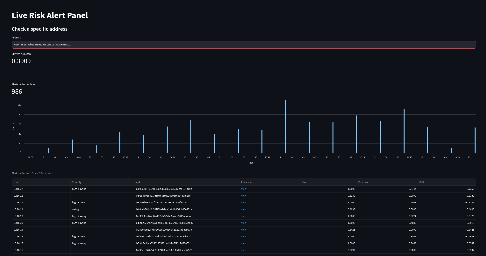

# Continuous Risk Scoring for Ethereum Wallets ⟠


*Presenting current state of alert dashboard*

(Polish version below)

I develop this project as the capstone for Sages' *AI & Machine Learning Engineering* course, building a live
risk-scoring system that reacts to Ethereum wallet activity on the fly. Because I wanted to tackle a streaming
problem, the system acts as a live predictor that updates wallet risk profiles in real time after every transaction.

Ultimately, I built this repository as a showcase of MLOps and systems-level thinking, demonstrating how solid pipeline
design and experiment tracking can be applied to messy, streaming data.

## How it works, in plain terms

**Stage 1 - Offline labeling.** There's no way to get freshly labeled fraud data for current
Ethereum activity, so the project starts from a historical, hand-labeled dataset (the February
2025 ByBit hack and its money-laundering trail) and trains a classifier on it. That classifier is
then used to generate probabilistic "soft" risk labels for fresh, unlabeled transfers pulled live
from BigQuery - a deliberate, documented workaround for the lack of ground truth on current data.

**Stage 2 - Temporal graph training.**  A Temporal Graph Network (PyTorch Geometric)
that maintains a per-address memory vector and updates it after every token transfer, trained
against the soft labels from Stage 1. A RiskHead decodes that memory directly into a risk score -
no separate model on top of the embeddings. Validation (time-based split, last 3 of the 14 days
held out): Spearman correlation ≈0.815 between predicted and target risk ranking.

**Stage 3 - Live inference.** A stateful, event-driven service built around the
trained TGN: new transfer events flow through a Kafka-compatible broker (Redpanda, single
partition - TGN memory updates are order-sensitive per address) into an inference consumer that
runs each event through the model, compares the new score against the last one in Redis, and
raises an alert when risk rises by more than a threshold. A FastAPI backend and Streamlit dashboard 
expose the alert feed and a spike chart of recent alerts. The whole demo path runs containerized via
`make demo` (see Quickstart below) - a replay producer substitutes for a live on-chain feed, so
trying it out needs no paid API key.

```
Chain Listener / Replay Producer --> Redpanda (1 partition) --> Inference Consumer
                                       (eth-transfers topic)      (TGN memory -> GNN -> RiskHead)
                                                                          |
                                                                          v
                                                    Redis (last score/address + periodic snapshot)
                                                                          |
                                                                          v
                                                 Alert Panel (FastAPI) --> Alert Dashboard (Streamlit)
```

## Current status

**Built and working (Stage 1):**
- Exploratory analysis of the historical labeled dataset
- A pipeline that pulls fresh Ethereum token-transfer data from BigQuery, deduplicates it, flags
  smart-contract addresses, and draws an activity-stratified address sample
- A data-quality sanity check on that fresh pull (duplicate diagnosis, schema drift, population
  overlap with the historical dataset, feature-distribution comparison)
- A feature-engineering module that runs in two modes: building a labeled training set from the
  historical data, or scoring features for fresh, unlabeled addresses
- An ensemble of independently-trained classifiers (one per feature family) with experiment
  tracking, SHAP-based diagnostics, and an automated acceptance gate against any single feature
  family dominating the result
- Generating soft risk labels for the sampled fresh addresses using the trained ensemble.

**Built and working (Stage 2 - temporal graph):**
- A Temporal Graph Network (PyTorch Geometric) with a GRU-based memory module, a GNN embedding
  layer, and a RiskHead decoder, trained end-to-end against the Stage 1 soft labels
- Checkpointing that preserves not just the learned weights but the full runtime memory/neighbor
  state, so inference can resume exactly where training left off
- Validation Spearman correlation ≈0.815 (time-based split, last 3 of 14 days held out)

**Built and working (Stage 3 - live inference):**
- Redpanda + Redis infrastructure (Docker Compose), a chain listener (live Alchemy feed) and a
  replay producer (demo mode, no live feed needed) publishing to the same topic
- An inference consumer: cold-start handling for addresses never seen in training, delta-based
  alerting, a gating rule that holds back alerts for addresses the live
  process hasn't "warmed up" on yet, and periodic Redis snapshots so a restart doesn't lose
  runtime state
- A FastAPI backend (alert feed + per-address score lookup) and a Streamlit dashboard (alert
  table, severity labels, Etherscan links, a dynamic spike chart of recent alerts)
- Per-microservice Docker images and a one-command demo (`make demo`) that fetches the model/data
  artifacts from Hugging Face Hub and brings up the whole stack

## Repository layout

```
src/
  data/       scripts that pull or prepare data (BigQuery fetches, contract lookups, sampling)
  features/   turns raw transfer data into a per-address feature table
  models/     trains the classifier ensemble (Stage 1) and the TGN (Stage 2)
  serving/    Stage 3 event-driven services (chain listener, replay producer, inference
              consumer, alert panel + dashboard)
notebooks/    exploratory analysis
docker/       Dockerfiles + compose files for the Stage 3 deploying stack
scripts/      one-off setup scripts (fetching model/data artifacts from Hugging Face Hub)
data/         raw/ interim/ processed/
mlruns/       local MLflow experiment-tracking store
```

## Tech stack

PyTorch / PyTorch Geometric (TGN) - XGBoost (Stage 1 ensemble) - MLflow (experiment tracking) -
Redpanda (Kafka-compatible broker) - Redis - FastAPI - Streamlit - Docker Compose - Hugging Face
Hub (model/data artifact hosting)

## A few design decisions worth knowing upfront

- **Scope is deliberately narrow**: only ERC-20 token transfer events, and only externally-owned accounts are scored.
  Both are documented simplifications, not gaps that were missed.
- **Transfer values are normalized without external price data**: a robust z-score (median/MAD of
  the log value), computed separately per token contract. This is self-referential - recomputed
  from whatever data is on hand rather than relying on a maintained price list - so it's resilient
  to token/market drift over time.
- **The classifier is an ensemble of feature-family specialists** (value, gas, behavioral,
  structural) rather than one model over all features. This avoids a single feature family
  dominating the result and gives a rough, secondary signal (how much the families disagree) for free.
- **Every script that can touch billed cloud resources defaults to a dry run.** Actually pulling
  data or querying BigQuery for real always requires an explicit "--execute" flag.

## Known limitations

- The historical training data comes from a single incident. Its label balance (~26% flagged as
  fraud-related) and address behavior don't reflect real-world Ethereum traffic, so soft labels
  are treated as a relative risk ranking, not a calibrated probability.
- The sanity-check notebook found a real distributional shift between the historical window and
  fresh data (eg. typical gas cost) - a reminder that the trained ensemble is extrapolating,
  rather than interpolating, when scoring current activity.
- Blending the ensemble's output with hand-written heuristics was part of the original Stage 1
  plan. for this pass - the ensemble's own consensus is used on its own and the heuristic blend
  was dropped as an unnecessary complication for now.
- Redis starts cold on every process restart - nothing seeds it with Stage 1's offline results,
  so the very first live event for any address (even one well known from 11 days of training
  history) can't raise an alert yet, since there's no previous score in Redis to compare against.
- The live pipeline doesn't scale horizontally by design: the broker topic has a single
  partition, because per-address TGN memory updates are order-sensitive and must stay in
  on-chain arrival order.
- ALERT_THRESHOLD and MIN_TRANSFERS_FOR_ALERT are provisional constants, set by inspection
  rather than tuned empirically against a real delta distribution.
- The replay producer's demo sample overlaps with the data the TGN was trained on - intentional:
  its job is to demonstrate the event-driven pipeline's mechanics.

## Roadmap - considered next steps

**Model quality:**
- Refine the current TGN architecture itself - hyperparameter tuning (memory dimension, GNN
  depth/width, learning rate schedule) and a closer look at the current model's validation
  metrics.
- Empirically tune `ALERT_THRESHOLD` and `MIN_TRANSFERS_FOR_ALERT` against the actual delta
  distribution from longer replay/live runs, instead of today's provisional values.
- Revisit blending the ensemble's soft labels with hand-written heuristics.
- Move from daily-granularity soft labels (Stage 1) to per-transfer labels - would need an
  incremental/streaming feature engine (particularly tricky for the median/MAD-based
  `value_zscore` feature, which has no simple incremental update formula).

**Live inference:**
- Seed Redis at startup with a one-time offline inference pass of the "trained TGN itself" over
  the full historical sample - gives every known address a comparable starting score instead of
  today's cold start.
- Horizontal scaling: the current single-partition topic is a deliberate simplification tied to
  per-address state ordering; a partitioned design with sticky address routing would remove the
  single-consumer ceiling.
- Move live `value` normalization to a proper rolling-window statistic per token contract,
  rather than reusing a static, once-fit z-score.

**Scope:**
- Bring `chain_listener.py` (live Alchemy feed) into the same containerized stack as the replay
  demo once a paid API key is available - already structurally reserved for in
  `docker-compose.app.yml` (shared producer image + `profiles: [live]`).
- GPU support for the inference consumer, if replay/live throughput is ever actually observed to
  be CPU-bound.
- Formalize secrets handling (`.env.example`, `.dockerignore`) for anyone else trying to run the
  live-feed path.
- Distinguish infrastructure smart contracts (routers, pools, bridges) from actually malicious
  ones (mixers, fake tokens, approval drainers) - today contracts aren't scored at all.

## Quickstart

```bash
uv sync
```

Two paths from here, depending on whether you want to see it running or train it yourself.

### Path A - just see it running (pretrained model from Hugging Face Hub)

```bash
make demo
```

Fetches the model/data artifacts from Hugging Face Hub if they aren't already present locally,
brings up Redpanda/Redis, and builds+starts the demo stack (replay producer, inference consumer,
alert panel, alert dashboard). Open `http://localhost:8501` for the dashboard
(`http://localhost:8000/alerts` for the raw alert feed). See `docker/README.md` for the
individual steps/targets and more detail. `make down` stops the demo stack; `make infra-down`
also stops Redpanda/Redis.


### Path B - train everything yourself

Stage 1 (each BigQuery-touching script prints a cost estimate and does nothing else unless you
pass "--execute"):

```bash
uv run python src/data/bq_fetch_day.py            # pull fresh transfer data
uv run python src/data/bq_contracts_fresh.py       # flag which fresh addresses are contracts
uv run python src/data/sample_fresh_addresses.py   # dedup + sample a subset of addresses
uv run python src/features/build_features.py --mode train   # historical, labeled feature table
uv run python src/features/build_features.py --mode score   # fresh, unlabeled feature table
uv run python src/models/train_xgboost_ensemble.py           # trains the ensemble, logs to MLflow
```

Stage 2 (soft labels + TGN training):

```bash
uv run python src/features/build_time_snapshots.py   # point-in-time feature snapshots, one per day
uv run python src/models/generate_soft_labels.py      # applies the ensemble, produces soft risk labels
uv run python src/models/build_temporal_graph.py      # builds the PyG TemporalData graph for training
uv run python src/models/train_tgn.py                 # trains the TGN, logs to MLflow, writes the checkpoint
```

Once you have your own `data/processed/tgn_checkpoint.pt`/`eth_fresh_temporal_graph.pt` and
`data/interim/eth_fresh_sample.parquet`, `make demo` uses those instead of fetching from Hugging
Face Hub - only downloads a file if it isn't already present locally.

------------------------------------------------------------------------------------
------------------------------------------------------------------------------------

# Szacowanie ryzyka live dla portfeli Ethereum ⟠


*Wizualizacja obecnego stanu dashboardu alertów*

Rozwijam ten projekt jako projekt końcowy kursu *AI & Machine Learning Engineering*, organizowanego przez Sages, budując system oceny ryzyka
działający na żywo, który na bieżąco reaguje na aktywność portfeli Ethereum. Ponieważ chciałem zmierzyć się z problemem
strumieniowym, system działa jako predyktor online, który aktualizuje profile ryzyka portfeli w czasie rzeczywistym po każdej transakcji.

Ostatecznie repozytorium to ma być prezentacją podejścia MLOps i myślenia systemowego - pokazuje, jak solidny projekt
pipeline'u i śledzenie eksperymentów można zastosować do nieuporządkowanych danych strumieniowych.

## Jak to działa, w prostych słowach

**Etap 1 - Etykietowanie offline.** Nie da się uzyskać świeżo oetykietowanych danych o oszustwach dla bieżącej
aktywności w sieci Ethereum, dlatego projekt wychodzi od historycznego, ręcznie oetykietowanego zbioru danych (włamanie
na ByBit z lutego 2025 r. i związany z nim ślad prania pieniędzy) i trenuje na nim klasyfikator. Klasyfikator ten jest
następnie używany do generowania probabilistycznych, „miękkich" etykiet ryzyka dla świeżych, nieoetykietowanych transferów
pobieranych na żywo z BigQuery - to świadome, udokumentowane obejście braku danych referencyjnych (ground truth) dla bieżących danych.

**Etap 2 - Trenowanie temporalnego modelu grafowego.** Temporalna sieć grafowa (Temporal
Graph Network, PyTorch Geometric), która utrzymuje wektor pamięci per adres i aktualizuje go po
każdym transferze tokena, trenowana względem miękkich etykiet z Etapu 1. RiskHead dekoduje tę
pamięć bezpośrednio na wynik ryzyka - bez dodatkowego modelu nad embeddingami. Walidacja (podział
czasowy, ostatnie 3 z 14 dni odłożone): korelacja Spearmana ≈0,815 między przewidywanym a
docelowym rankingiem ryzyka.

**Etap 3 - Inferencja na żywo.**  Stanowa, sterowana zdarzeniami usługa zbudowana wokół
wytrenowanego TGN: nowe zdarzenia transferu wpadają przez broker kompatybilny z Kafką (Redpanda,
jedna partycja - pamięć TGN jest stanowa i wymaga zachowania kolejności per adres) do konsumenta
inferencyjnego, który przepuszcza każde zdarzenie przez model, porównuje nowy wynik z ostatnim
zapisanym w Redis i generuje alert, gdy ryzyko wzrasta o więcej niż próg . Backend FastAPI i
dashboard w Streamlicie udostępniają listę alertów i  wykres "spike'ów" ostatnich alertów. Cała
ścieżka demo działa skonteneryzowana przez `make demo` (patrz Szybki start poniżej) - producent
odtwarzający nagrane dane zastępuje żywy feed on-chain, więc wypróbowanie nie wymaga płatnego klucza API.

```
Chain Listener / Replay Producer --> Redpanda (1 partycja) --> Inference Consumer
                                       (topic eth-transfers)     (TGN memory -> GNN -> RiskHead)
                                                                          |
                                                                          v
                                                    Redis (ostatni wynik/adres + okresowy snapshot)
                                                                          |
                                                                          v
                                                 Alert Panel (FastAPI) --> Alert Dashboard (Streamlit)
```

## Aktualny stan

**Zbudowane i działające (Etap 1):**
- Eksploracyjna analiza historycznego, oetykietowanego zbioru danych
- Pipeline, który pobiera świeże dane o transferach tokenów Ethereum z BigQuery, usuwa duplikaty, oznacza
  adresy smart kontraktów i losuje próbkę adresów warstwowaną według poziomu aktywności
- Kontrola jakości danych dla tego świeżego pobrania (diagnoza duplikatów, dryf schematu, pokrycie populacji
  z historycznym zbiorem danych, porównanie rozkładów cech)
- Moduł inżynierii cech działający w dwóch trybach: budowanie oetykietowanego zbioru treningowego z danych
  historycznych lub wyliczanie cech dla świeżych, nieoetykietowanych adresów
- Zespół (ensemble) niezależnie trenowanych klasyfikatorów (po jednym na każdą rodzinę cech) ze śledzeniem eksperymentów,
  diagnostyką opartą na SHAP i automatyczną bramką akceptacyjną chroniącą przed zdominowaniem wyniku przez
  jedną rodzinę cech
- Generowanie miękkich etykiet ryzyka dla wylosowanych świeżych adresów przy użyciu wytrenowanego zespołu.

**Zbudowane i działające (Etap 2 - model grafowy):**
- Temporalna sieć grafowa (PyTorch Geometric) z modułem pamięci na bazie GRU, warstwą GNN i
  dekoderem RiskHead, trenowana end-to-end względem miękkich etykiet z Etapu 1
- Checkpointing zachowujący nie tylko wyuczone wagi, ale cały stan pamięci/sąsiadów w czasie
  działania, dzięki czemu inferencja może kontynuować dokładnie tam, gdzie skończył się trening
- Korelacja Spearmana na walidacji ≈0,815 (podział czasowy, ostatnie 3 z 14 dni odłożone)

**Zbudowane i działające (Etap 3 - inferencja na żywo):**
- Infrastruktura Redpanda + Redis (Docker Compose), chain listener (żywy feed Alchemy) i
  producent odtwarzający nagrane dane (tryb demo, bez potrzeby żywego feedu), publikujące do
  tego samego topicu
- Konsument inferencyjny: obsługa cold-startu dla adresów nieznanych z treningu, alertowanie na
  bazie delty (tylko przy rosnącym ryzyku), reguła "rozgrzania" wstrzymująca alerty dla adresów,
  których proces jeszcze nie "poznał", oraz okresowe snapshoty do Redis, żeby restart nie gubił
  stanu działania
- Backend FastAPI (lista alertów + wyszukiwanie wyniku per adres) i dashboard w Streamlicie
  (tabela alertów, etykiety severity, linki do Etherscan, wykres "spike'ów" ostatnich alertów w
  stylu DownDetector)
- Obrazy Dockera per mikroserwis i jednokomendowe demo (`make demo`), które pobiera artefakty
  modelu/danych z Hugging Face Hub i stawia cały stack

## Struktura repozytorium

```
src/
  data/       skrypty pobierające lub przygotowujące dane (zapytania do BigQuery, wyszukiwanie kontraktów, próbkowanie)
  features/   przekształca surowe dane o transferach w tabelę cech per adres
  models/     trenuje zespół klasyfikatorów (Etap 1) i TGN (Etap 2)
  serving/    usługi event-driven Etapu 3 (chain listener, replay producer, inference consumer,
              alert panel + dashboard)
notebooks/    analiza eksploracyjna
docker/       Dockerfile'e + pliki compose dla stacku demo Etapu 3
scripts/      skrypty jednorazowe (pobieranie artefaktów modelu/danych z Hugging Face Hub)
data/         raw/ interim/ processed/
mlruns/       lokalne repozytorium śledzenia eksperymentów MLflow
```

## Stack technologiczny

PyTorch / PyTorch Geometric (TGN) - XGBoost (zespół z Etapu 1) - MLflow (śledzenie
eksperymentów) - Redpanda (broker kompatybilny z Kafką) - Redis - FastAPI - Streamlit - Docker
Compose - Hugging Face Hub (hosting artefaktów modelu/danych)

## Kilka decyzji projektowych, które warto znać od początku

- **Zakres jest celowo wąski**: uwzględniane są wyłącznie zdarzenia transferów tokenów ERC-20 i oceniane są tylko
  konta zewnętrzne (EOA). Oba te uproszczenia są udokumentowane - to nie przeoczone luki.
- **Wartości transferów są normalizowane bez zewnętrznych danych cenowych**: stosowany jest odporny z-score (mediana/MAD
  logarytmu wartości), liczony osobno dla każdego kontraktu tokena. Jest to podejście samoodniesieniowe - wyliczane
  na nowo z dostępnych danych zamiast polegania na utrzymywanej liście cen - dzięki czemu jest odporne
  na dryf tokenów i rynku w czasie.
- **Klasyfikator to zespół specjalistów od poszczególnych rodzin cech** (wartość, gas, zachowanie,
  struktura), a nie jeden model na wszystkich cechach. Dzięki temu żadna rodzina cech nie dominuje wyniku,
  a przy okazji otrzymujemy przybliżony, pomocniczy sygnał (stopień niezgodności między rodzinami).
- **Każdy skrypt, który może korzystać z płatnych zasobów chmurowych, domyślnie działa w trybie próbnym (dry run).**
  Faktyczne pobranie danych lub wykonanie zapytania do BigQuery zawsze wymaga jawnego podania flagi "--execute".

## Znane ograniczenia

- Historyczne dane treningowe pochodzą z jednego incydentu. Ich rozkład etykiet (~26% oznaczonych jako
  powiązane z oszustwem) oraz zachowanie adresów nie odzwierciedlają rzeczywistego ruchu w sieci Ethereum, dlatego miękkie
  etykiety traktowane są jako względny ranking ryzyka, a nie skalibrowane prawdopodobieństwo.
- Notebook kontroli jakości wykazał rzeczywiste przesunięcie rozkładów między oknem historycznym a świeżymi
  danymi (np. typowy koszt gasu) - co przypomina, że wytrenowany zespół przy ocenie bieżącej aktywności
  ekstrapoluje, a nie interpoluje.
- Łączenie wyniku zespołu z ręcznie napisanymi heurystykami było częścią pierwotnego planu Etapu 1.
  Na tym etapie wykorzystywany jest wyłącznie konsensus samego zespołu, a łączenie z heurystykami
  zostało na razie porzucone jako zbędna komplikacja.
- Redis startuje "na zimno" przy każdym restarcie procesu - nic nie zasila go offline'owymi
  wynikami z Etapu 1, więc pierwsze żywe zdarzenie dla KAŻDEGO adresu (nawet dobrze znanego z 11
  dni historii treningowej) nie może jeszcze wygenerować alertu - nie ma w Redis poprzedniego
  wyniku do porównania.
- Pipeline na żywo świadomie nie skaluje się horyzontalnie: topic brokera ma jedną partycję, bo
  aktualizacje pamięci TGN per adres są stanowe i muszą zachować kolejność zgodną z porządkiem
  on-chain.
- ALERT_THRESHOLD i MIN_TRANSFERS_FOR_ALERT to prowizoryczne stałe, ustalone przez inspekcję,
  nie wytuningowane empirycznie na realnym rozkładzie delt.
- Próbka demo producenta odtwarzającego nagrane dane nakłada się czasowo z danymi, na których
  trenowany był TGN, podejście umożlwia powtrzalną reprodukcje zdarzenień dla dalszego rozwijania / testów.

## Dalszy rozwój - rozważane następne kroki

**Jakość modelu:**
- Dopracowanie obecnej architektury TGN - praca nad hiperparametrami (wymiar pamięci,
  głębokość/szerokość GNN, harmonogram learning rate) oraz dokładniejsza analiza metryk
  walidacyjnych obecnego modelu.
- Empiryczne dotuningowanie `ALERT_THRESHOLD` i `MIN_TRANSFERS_FOR_ALERT` względem realnego
  rozkładu delt z dłuższych przebiegów replay/live, zamiast dzisiejszych prowizorycznych wartości.
- Powrót do łączenia miękkich etykiet zespołu z ręcznie napisanymi heurystykami (odłożone na
  tym etapie - patrz "Znane ograniczenia").
- Przejście z dziennej granulacji miękkich etykiet (Etap 1) na granulację per-transfer - wymaga
  inkrementalnego/strumieniowego silnika cech (szczególnie trudne dla cechy `value_zscore`
  opartej na medianie/MAD, która nie ma prostego wzoru na aktualizację przyrostową).

**Inferencja na żywo:**
- Zasilenie Redisa przy starcie jednorazowym, offline'owym przebiegiem inferencyjnym *samego
  wytrenowanego TGN* po całej historycznej próbce (nie miękkimi etykietami z zespołu XGBoost z
  Etapu 1, które żyją na innej skali) - daje każdemu znanemu adresowi porównywalny wynik
  startowy zamiast dzisiejszego cold-startu.
- Skalowanie horyzontalne: dzisiejszy topic z jedną partycją to świadome uproszczenie związane z
  wymogiem kolejności stanu per adres; podział na partycje z przypisanym routingiem adresów
  usunąłby obecny sufit jednego konsumenta.
- Przeniesienie normalizacji `value` dla live scoringu na właściwą statystykę typu rolling
  window per kontrakt tokena, zamiast ponownego użycia statycznego, jednorazowo dopasowanego
  z-score'u.

**Zakres:**
- Włączenie `chain_listener.py` (żywy feed Alchemy) do tego samego skonteneryzowanego stacku co
  demo replay, gdy dostępny będzie płatny klucz API - miejsce już zarezerwowane architektonicznie
  w `docker-compose.app.yml` (wspólny obraz producenta + `profiles: [live]`).
- Wsparcie GPU dla konsumenta inferencyjnego, jeśli przepustowość replay/live faktycznie okaże
  się ograniczona przez CPU.
- Formalizacja obsługi sekretów (`.env.example`, `.dockerignore`) dla każdego, kto chciałby
  odpalić ścieżkę z żywym feedem.
- Rozróżnienie infrastrukturalnych smart kontraktów (routery, pule, mosty) od faktycznie
  złośliwych (miksery, fałszywe tokeny, drenaże zatwierdzeń) - obecnie kontrakty nie są scorowane
  wcale (patrz "zakres jest celowo wąski" powyżej).

## Szybki start

```bash
uv sync
```

Od tego miejsca dwie ścieżki, zależnie od tego, czy chcesz zobaczyć projekt w akcji, czy
samodzielnie przeprowadzić trening.

### Ścieżka A - po prostu zobacz to w akcji (wytrenowany model z Hugging Face Hub)

```bash
make demo
```

Pobiera artefakty modelu/danych z Hugging Face Hub, jeśli nie są jeszcze obecne lokalnie, stawia
Redpandę/Redis i buduje+odpala stack demo (producent odtwarzający nagrane dane, konsument
inferencyjny, panel alertów, dashboard alertów). Otwórz `http://localhost:8501` dla dashboardu
(`http://localhost:8000/alerts` dla surowej listy alertów). Zobacz `docker/README.md` po
pojedyncze kroki/targety i więcej szczegółów. `make down` zatrzymuje stack demo; `make
infra-down` zatrzymuje też Redpandę/Redis.

### Ścieżka B - przeprowadź trening samodzielnie

Etap 1 (każdy skrypt korzystający z BigQuery wyświetla szacunkowy koszt i nie robi nic więcej,
dopóki nie podasz "--execute"):

```bash
uv run python src/data/bq_fetch_day.py            # pobiera świeże dane o transferach
uv run python src/data/bq_contracts_fresh.py       # oznacza, które świeże adresy są kontraktami
uv run python src/data/sample_fresh_addresses.py   # usuwa duplikaty + losuje podzbiór adresów
uv run python src/features/build_features.py --mode train   # historyczna, oetykietowana tabela cech
uv run python src/features/build_features.py --mode score   # świeża, nieoetykietowana tabela cech
uv run python src/models/train_xgboost_ensemble.py           # trenuje zespół, loguje do MLflow
```

Etap 2 (miękkie etykiety + trening TGN):

```bash
uv run python src/features/build_time_snapshots.py   # migawki cech point-in-time, jedna per dzień
uv run python src/models/generate_soft_labels.py      # stosuje zespół, generuje miękkie etykiety ryzyka
uv run python src/models/build_temporal_graph.py      # buduje grafowy TemporalData (PyG) do treningu
uv run python src/models/train_tgn.py                 # trenuje TGN, loguje do MLflow, zapisuje checkpoint
```

Gdy masz już własny `data/processed/tgn_checkpoint.pt`/`eth_fresh_temporal_graph.pt` oraz
`data/interim/eth_fresh_sample.parquet`, `make demo` użyje ich zamiast pobierać z Hugging Face
Hub - `scripts/fetch_artifacts.py` pobiera plik tylko wtedy, gdy nie jest jeszcze obecny lokalnie.
